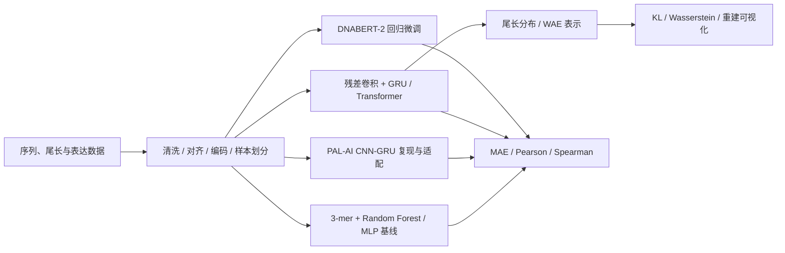

# PolyA_AI

**从 PAL-AI 论文复现，到拟南芥叶片三代测序数据的 poly(A) 尾长预测。**

一个生物序列机器学习研究项目，覆盖数据处理、传统机器学习基线、深度学习、分布表示学习和预训练模型微调。这里展示的不只是模型代码，也包括原始 notebook 中的结果图、实验局限与后续验证计划。

**技术栈：** Python · pandas / NumPy · scikit-learn · TensorFlow / Keras · PyTorch · Transformers / DNABERT-2 · POT · Jupyter · HPC 作业脚本

## 三分钟阅读路线

1. 看下方两组结果，了解任务与当前表现。
2. 阅读 [结果解读与局限](docs/RESULTS.md)，区分论文复现、拟南芥迁移和探索性实验。
3. 按 [代码阅读路线](docs/PORTFOLIO_GUIDE.md) 查看数据处理、模型实现、评估和下一步改进。
4. 深入 [ai.ipynb](ai.ipynb) 与 [ai_polyA.ipynb](ai_polyA.ipynb)：关键统计输出和全部 PNG 图已恢复，无需先训练即可浏览。

## 问题与实验路线

**问题：** 序列信息能够在多大程度上解释 poly(A) 尾长？从预测一个中位数，到预测整个尾长分布或单条读段，模型会遇到什么变化？

## 代表性结果：复现与迁移要分开看

### PAL-AI 复现实验

原始图记录 **n=6,053，Pearson r=0.79，Spearman ρ=0.79**；来源为 `ai.ipynb` 原始单元 19，读取 `XL_oo_pp` 交叉验证预测结果。这是 PAL-AI 复现数据的结果，**不能代表 ara_leaf 上的性能**，也不是本次重新运行得到的指标。

### 拟南芥叶片：从预测分布还原中位数

原始图记录 **n=11,519，Pearson r=0.44，Spearman ρ=0.49**；来源为原始单元 172，读取 sequence-only / cross-entropy 分布模型的历史 CV 预测表。图中仍存在向均值收缩和极端尾长预测不足，后续需要独立分组测试验证泛化。

更多 [基线、分布重建与单读段结果](docs/RESULTS.md) 包含表现较弱的实验；不将单个样本的重建效果当作总体准确率，也不将不同数据集的数字直接排名。

## 本项目展示的实践

| 实践 | 可查看的证据 |
| --- | --- |
| 论文复现与框架实现 | `PAL-AI/pal-ai.py`、`PAL-AI/pal-ai_torch.py` |
| 特征工程和基线比较 | `ai_polyA.ipynb` 中的 3-mer 频率、Random Forest 与 MLP |
| 序列深度学习 | `single_read/ara_leaf/`、`polya_dist/ath/` 中的卷积、GRU、注意力模块 |
| 分布建模与表示分析 | `polya_dist/embedding/wae/`、`polya_dist/1_resgrutransformer/`、潜变量和重建图 |
| 预训练模型回归适配 | `dnabert2/polya_single_read/` 中的数据集、回归头和训练循环 |
| 实验诊断与研究判断 | [结果说明](docs/RESULTS.md) 中的负面结果、数据划分与指标边界 |
| 多服务器实验整理 | LSF / PBS 作业示例、[环境说明](docs/ENVIRONMENTS.md)、[文件来源清单](docs/source_manifest.tsv) |

PAL-AI 的基础方法来自原论文；DNABERT-2 backbone 来自上游预训练模型。本仓库呈现复现实验、任务适配、实验脚本与分析记录，不主张发明这些基础架构。第三方模型代码和许可证保留在对应目录。

## 代码导航

| 路径 | 内容 |
| --- | --- |
| `ai.ipynb` | PAL-AI、极值、尾长分布、WAE、拟南芥及单读段实验记录 |
| `ai_polyA.ipynb` | 传统机器学习 / MLP 基线与特征探索 |
| `PAL-AI/`、`polya_med/`、`pal_polya_med/` | 复现、中位数模型、训练与评估脚本 |
| `extremum_test/` | 极端尾长实验 |
| `polya_dist/` | 分布预测、残差 GRU-Transformer 和 WAE |
| `single_read/ara_leaf/` | 叶片单读段回归实验 |
| `dnabert2/polya_single_read/` | DNABERT-2 微调及 gene_200 数据划分版本 |
| `figures/` | 从原 notebook 原样导出的 PNG，见 [图索引](figures/README.md) |

## 运行与复现状态

当前是**带历史结果的研究代码作品集**。本次整理未重新训练模型，也未完成干净环境下的端到端复现。

- 先读 [环境说明](docs/ENVIRONMENTS.md) 与 [数据 / 路径说明](docs/DATA_AND_PATHS.md)，准备数据、权重和输出目录。
- 训练脚本保留原服务器路径；部分模块在导入时就会训练，不能直接当作通用 Python 包使用。
- 原始测序数据、训练数组和模型权重不在仓库中。notebook 保留有限结果预览与统计图；这与上传完整训练数据不同。
- 缓存结果来自多次实验，执行顺序不一定连续。已知问题和分组验证改进见 [阅读路线与改进计划](docs/PORTFOLIO_GUIDE.md)。
- 本次验证范围：notebook JSON、图像完整性、源码不变性、文档链接、来源哈希；不等同于结果复算。

## 方法来源

- [PAL-AI](https://github.com/coffeebond/PAL-AI)：Xiang, K. & Bartel, D. P. *Nature Communications* 16, 7079 (2025). [DOI](https://doi.org/10.1038/s41467-025-62171-5)
- [DNABERT-2](https://github.com/zhihan1996/DNABERT_2) · [预训练模型](https://huggingface.co/zhihan1996/DNABERT-2-117M)

项目自有代码暂未指定统一开源许可证；第三方文件沿用各自许可。代码归档来源为 IPF 与 Cryo-EM，原始项目未修改。
