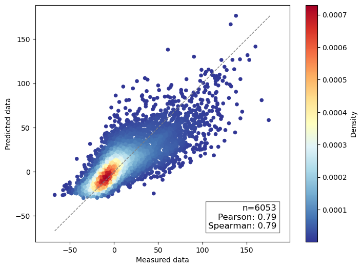
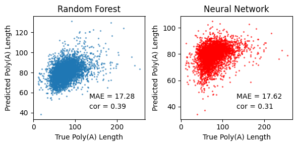
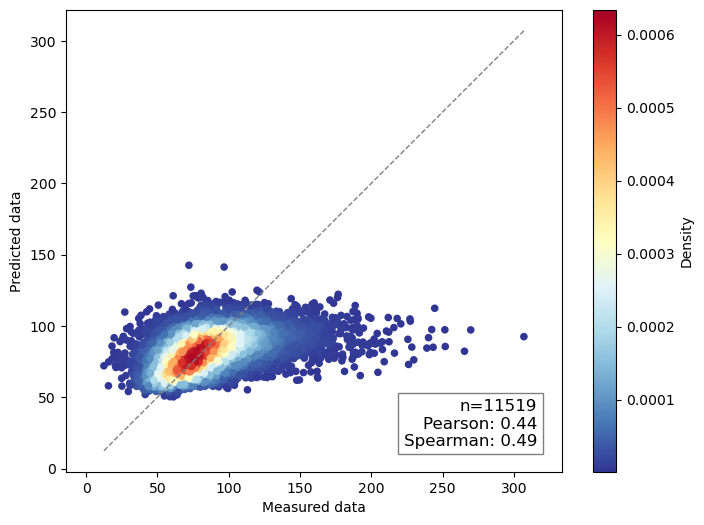
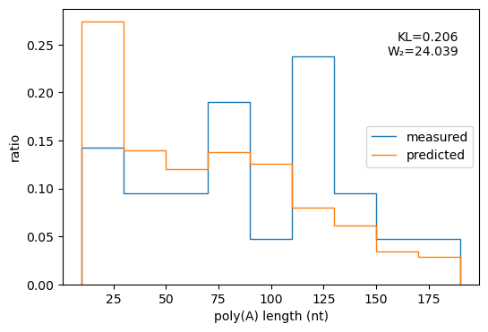
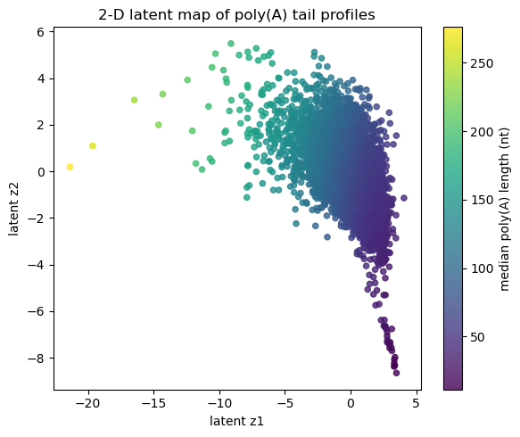
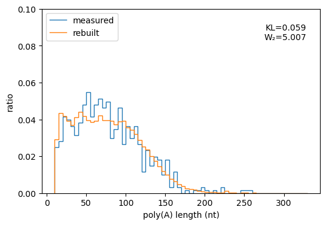
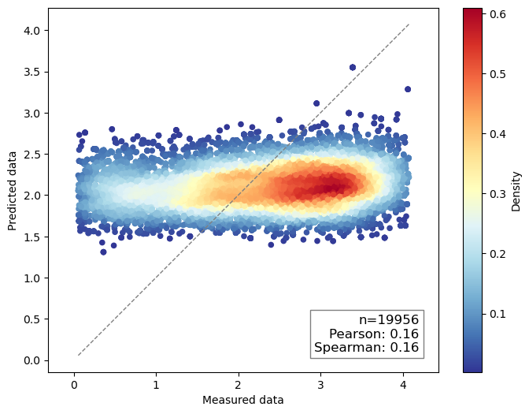

# 结果解读：保留证据，也保留边界

以下数字均从原始 notebook 已保存的输出或图片读取，**未在本次整理中重新计算**。`原始单元` 指服务器原文件中的 1-based 单元序号；仓库 notebook 的源码单元元数据保存该编号。相关系数是 Pearson r / Spearman ρ，不是决定系数 R²。

## 1. PAL-AI 复现

- 来源：`ai.ipynb` 原始单元 19；其前面的训练代码使用 KFold，并在各折重复训练与选择模型。
- 图中结果：n=6,053，Pearson r=0.79，Spearman ρ=0.79。
- 数据上下文：`XL_oo_pp` 预测表，属于 PAL-AI 复现，不是拟南芥叶片。
- 注意：折内验证和重复选模可能带来选择偏差；尚未补做独立外部测试或嵌套 CV，不能据此宣称与论文等价或超越论文。

## 2. 3-mer 基线：Random Forest 与 MLP

- 来源：`ai_polyA.ipynb` 原始单元 26，使用抽样 20,000 条记录、80/20 随机划分；单元 18 保存测试集数 4,000。
- 当前这张缓存图：Random Forest MAE≈17.28、Pearson r≈0.39；MLP MAE≈17.62、Pearson r≈0.31。
- 在这次记录中，MLP 没有优于随机森林，说明增加模型复杂度本身不足以改善泛化。
- 数据来自另一份多物种基因序列/中位数表，不与 ara_leaf 或 PAL-AI 数字直接比较。
- 同 notebook 后续缓存图存在另一组指标（例如 RF MAE≈17.70、MLP MAE≈18.82），保留为历史探索，不拼成同一轮实验。代码也把测试划分用于训练时验证，这不是未触碰的最终测试集。

## 3. 拟南芥分布预测与中位数评估

- 来源：`ai.ipynb` 原始单元 167–172，sequence-only / cross-entropy 历史 CV 预测表。
- 从预测分布插值计算中位数：n=11,519，Pearson r=0.44，Spearman ρ=0.49。
- 图中误差具有结构性：预测值集中在中间区域，长尾与短尾样本不足以被充分区分。
- 加 CPM 的相邻实验区段中，原始单元 176 仍引用 `res` 而非 `res_cpm`；因此单元 179 的中位数散点图不能作为 CPM 带来收益的证据。此次保留代码与输出，明确记录该问题，未静默修图或改数字。

单样本预测示例（原始单元 168）：

图中的 KL/W₂ 仅对该样本成立，不能替代全体样本平均值与置信区间。

## 4. WAE 表示学习与重建

来源：`ai.ipynb` 原始单元 102、108。潜变量与尾长分布特征的关系、重建图及 KL/Wasserstein 指标体现对分布表征的探索。它们是重建/探索证据，不能直接等同于从序列预测的测试准确率。

## 5. 单读段回归：保留负面结果

- 来源：`ai.ipynb` 原始单元 209–212。
- 图中结果：n=19,956，Pearson r=0.16，Spearman ρ=0.16；预测明显向均值收缩。
- 横轴由 `log1p`、标准化及平移构造，不是原始 nt 尺度，不与原始尾长 MAE 混用。
- notebook 中可见分别拟合 eval/test scaler 的探索代码；应改为仅在训练集拟合、统一应用到验证/测试集，并重新生成预测与指标后再讨论泛化。当前不将此图包装成成功模型。

## 如何进一步证明效果

优先固定 gene/transcript 或染色体分组的独立测试集，防止相似序列或同一基因读段跨集合；在训练集拟合归一化；统一数据版本、split 和指标；报告多随机种子均值/波动、简单基线、置信区间及误差分层。DNABERT-2 的微调代码已收录，但尚无本次可核对的统一结果表，不宣称其优于其他模型。
